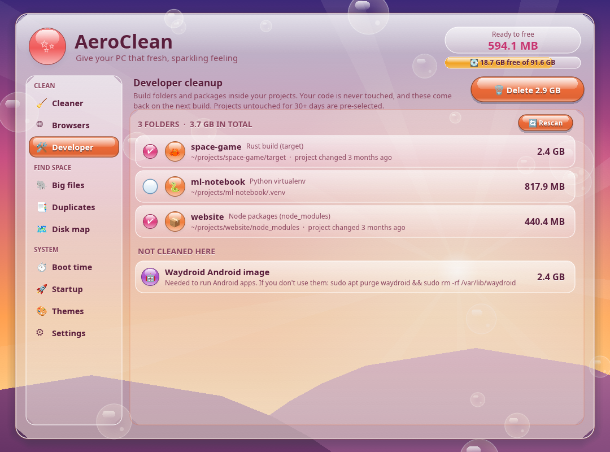
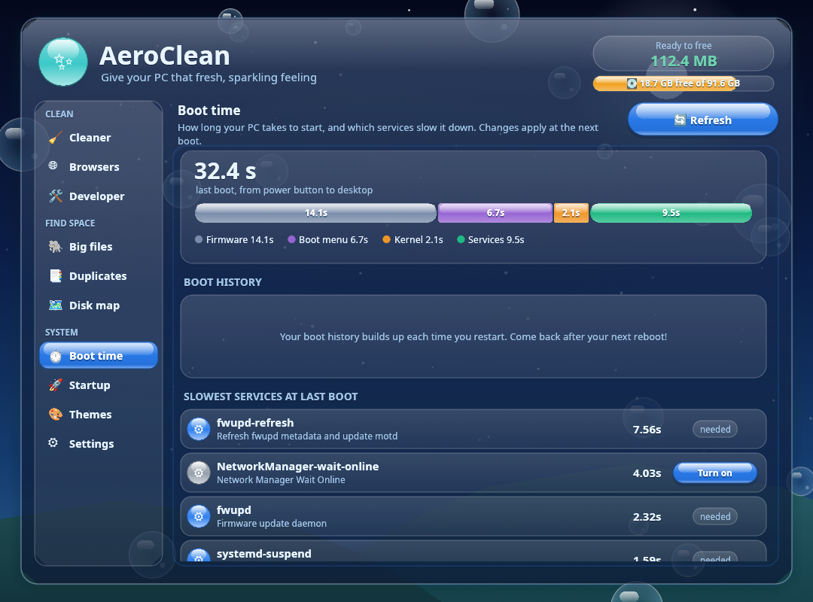
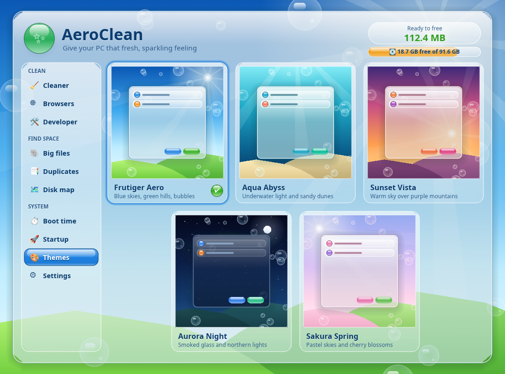

<p align="center"></p>

<h1 align="center">AeroClean</h1>

<p align="center">A system cleaner for Linux Mint and Ubuntu with a glossy 2000s <b>Frutiger Aero</b> look.<br>
Written in Rust with <a href="https://github.com/emilk/egui">egui</a>. English and French.</p>


## Features

**Clean**
- **Cleaner:** trash, thumbnails, app and browser caches, developer caches, recent files list, unused Flatpak runtimes, APT cache, unused packages and old kernels, system journal, rotated logs, crash reports and old temp files. System items ask for your password **once** (pkexec).
- **Review before cleaning:** see exactly what will be removed. AeroClean warns you if a browser is open.
- **Browsers:** cache, cookies and history, chosen separately, for Brave, Chrome, Chromium, Vivaldi, Edge and Firefox.
- **Developer:** Rust `target/` folders, `node_modules` and Python virtualenvs, with "last changed" dates. Stale projects are pre-selected.

**Find space**
- **Big files**, with warnings for duplicates and files that belong to apps.
- **Duplicates**, compared by content. The oldest copy is kept as the original.
- **Disk map:** a treemap of your home folder that you can click into.

**System**
- **Boot time:** last boot by stage (firmware, boot menu, kernel, services), boot history, and the slowest services with on/off toggles. System-critical services are locked.
- **Startup apps:** turn login apps on or off. Only your own settings change, never system files.
- **Automation:** a weekly automatic clean and a low disk space alert (systemd user timers, no password needed).

**Make it yours**
- 5 themes: Frutiger Aero, Aqua Abyss, Sunset Vista, Aurora Night and Sakura Spring.
- Folders to keep, journal retention, big file threshold, a remembered selection, and language.
- Battery friendly: animations pause when the window isn't active, and there's a "Reduce motion" option.

| | |
|---|---|
|  |  |
|  |  |



## Safety

- Deletion never follows symbolic links, and files in use are skipped, never forced.
- Risky items (unused packages, cookies, history, developer folders) are off by default or need a second click.
- Big files and duplicates go to the **Trash**, so they can be restored.
- System files are never edited: startup changes are per-user overrides.
- Every cleaning step is covered by automated tests that run on throwaway folders.

## Install

**From a release:** download `aero-cleaner_<version>_amd64.deb` from the Releases page, then:

```sh
sudo apt install ./aero-cleaner_*_amd64.deb
```

**From source** (needs [Rust](https://rustup.rs)):

```sh
cargo build --release
cp target/release/aero-cleaner ~/.local/bin/
aero-cleaner   # the first run adds AeroClean to your menu
```

**Build the .deb yourself:** `packaging/build-deb.sh` (needs `librsvg2-bin`). The package is written to `target/deb/`.

## Command line

```text
aero-cleaner                 open the app
aero-cleaner --tab <name>    open on a screen (cleaner, browsers, dev, big, dupes, map, boot, startup, themes, settings)
aero-cleaner clean --auto    run the automatic clean and show a notification
aero-cleaner check-disk      notify if free space is below the alert threshold
```

Right-click AeroClean in the menu for **Quick clean** and **Disk map**.

## Development

```sh
cargo test                        # 21 tests
AERO_I18N_MISSING=1 cargo run     # with language=fr, prints untranslated strings
```

| Folder | Contents |
|---|---|
| `src/cleaner.rs`, `browsers.rs`, `devclean.rs`, `dupes.rs`, `diskmap.rs`, `boot.rs`, `automation.rs`, `tools.rs` | Backends (no UI) |
| `src/tabs/` | One file per screen |
| `src/aero.rs`, `theme.rs` | Frutiger Aero drawing kit and themes |
| `src/i18n.rs` | French translation |

See [ROADMAP.md](ROADMAP.md) for what's done and what's next.
