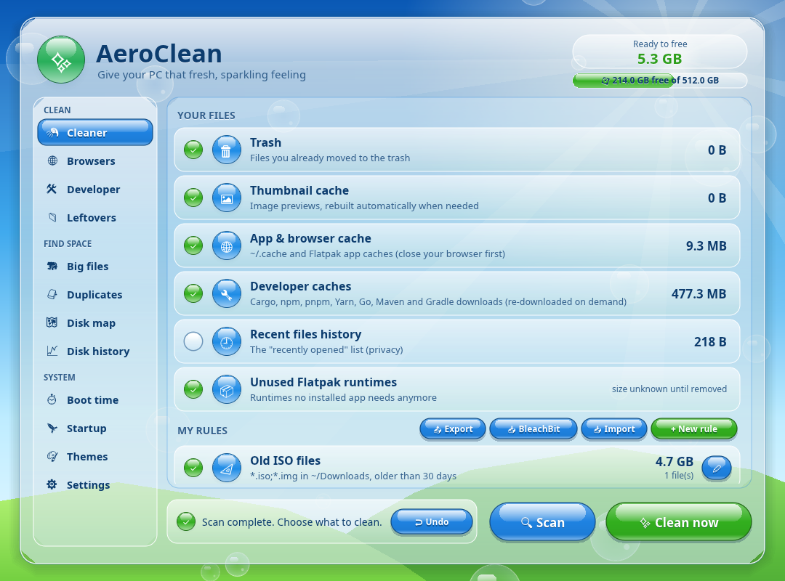
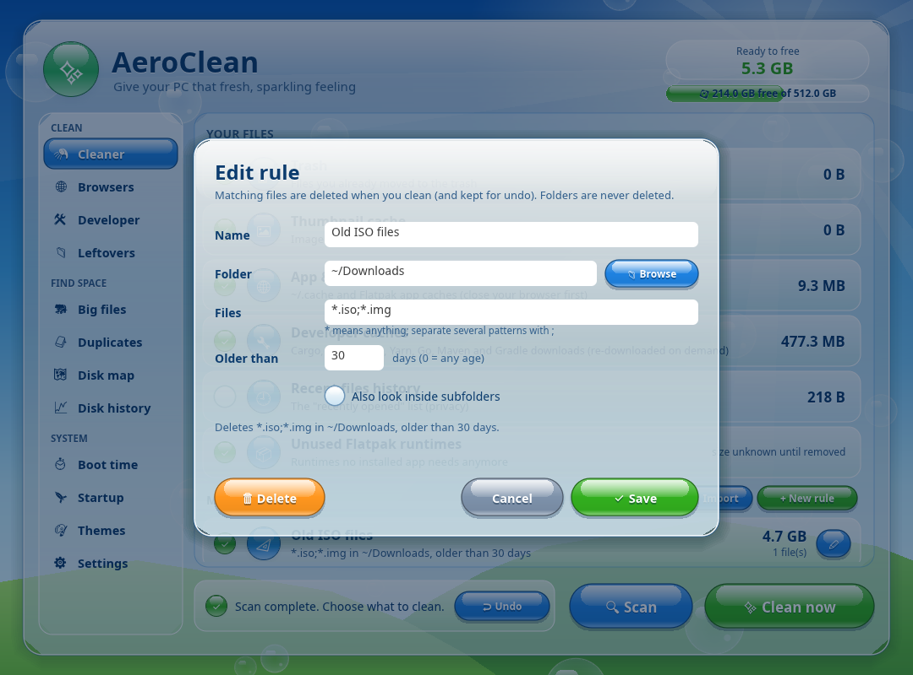
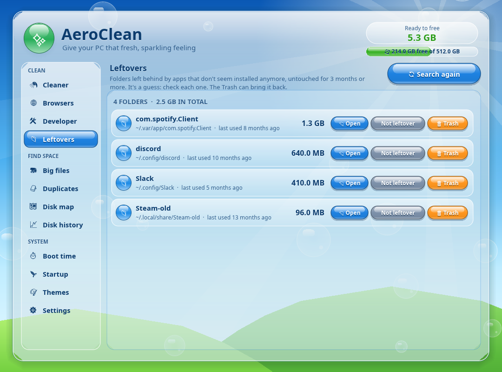
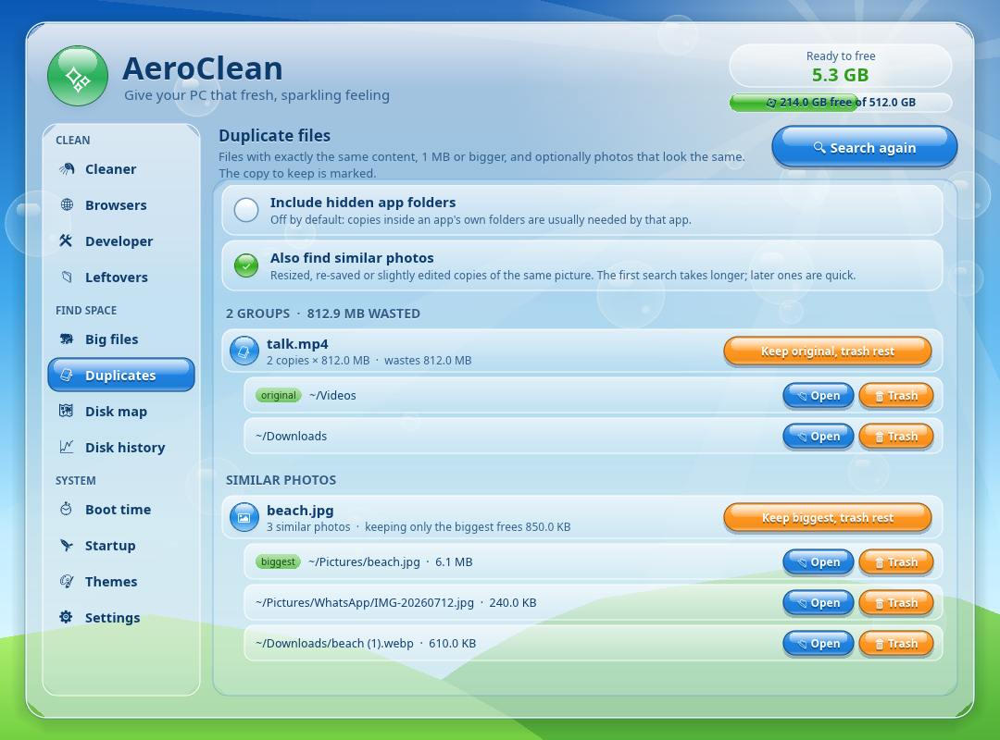
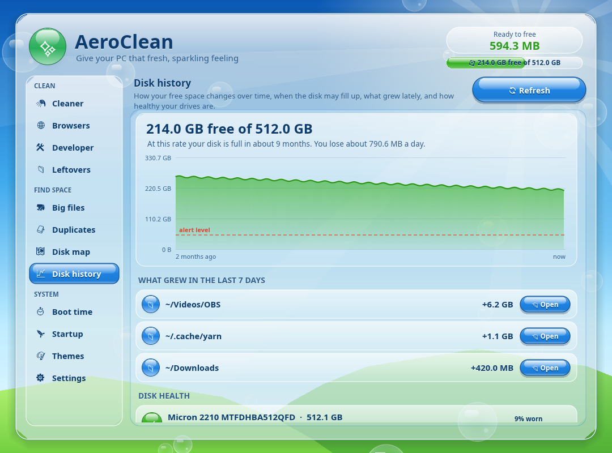
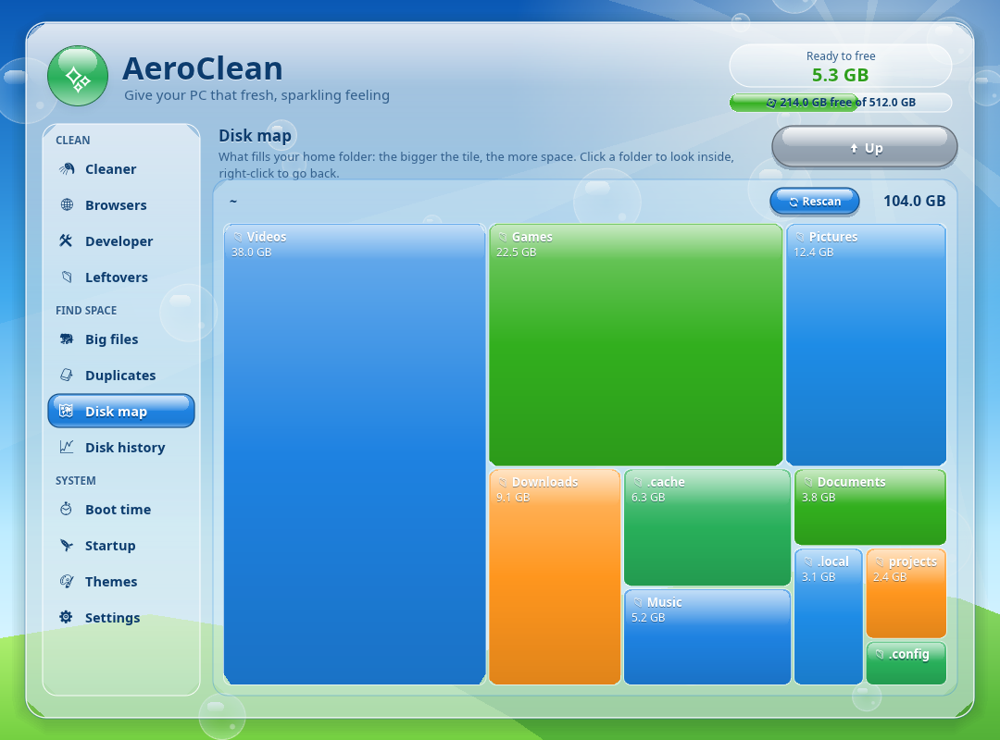
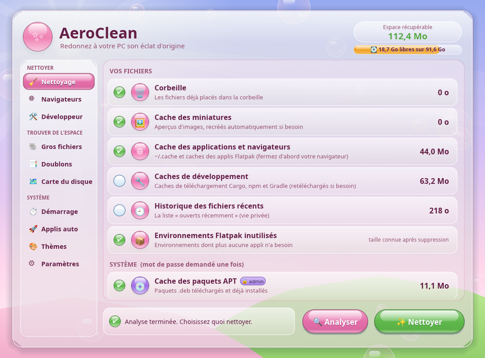

<p align="center"></p>

<h1 align="center">AeroClean</h1>

<p align="center">A system cleaner for <b>Linux</b> (Mint, Ubuntu, Fedora, Arch, openSUSE), <b>Windows 10/11</b> and <b>macOS 11+</b> with a glossy 2000s <b>Frutiger Aero</b> look.<br>
Written in Rust with <a href="https://github.com/emilk/egui">egui</a>. English, French, Spanish, German and Portuguese.</p>



## Features

### Overview
- **Your PC at a glance:** AeroClean opens on a health score out of 100 built from free space, junk waiting to be cleaned, drive health, boot time and being up to date, with a card per area and **✨ Fix all safe items** (it still shows you the list first).

### Clean
- **Cleaner:** caches, thumbnails, the Trash, crash reports, old logs and temp files, unused packages (APT, DNF, pacman or zypper plus Flatpak and old Snap revisions on Linux, Homebrew on macOS, superseded components on Windows) and developer download caches (Cargo, npm, pnpm, Yarn, Go, Maven, Gradle). System items ask for your password once, through a small helper that does each system operation on its own (see Safety).
- **Review first:** a "Ready to clean?" sheet lists exactly what will go, and warns you if a browser is open.
- **Undo:** cleaned files are kept for 24 hours (3 days, a week or off). **↩ Undo** puts the last clean back, and Settings lists every kept clean. Nothing is kept when the disk is almost full.
- **My rules:** your own rules, like "`*.iso` in `~/Downloads` older than 30 days", made in an editor and cleaned with everything else. Share them as a plain text file, or import **BleachBit**'s cleaners for the apps you have installed.
- **Browsers:** cache, cookies and history, chosen separately, for Brave, Chrome, Chromium, Vivaldi, Edge and Firefox. Firefox history is removed page by page, so your bookmarks stay.
- **Developer:** Rust `target/` folders, `node_modules` and Python virtualenvs with "last changed" dates (stale projects are pre-selected), plus unused Docker or Podman images, stopped containers and build cache (never volumes).
- **Leftovers:** folders left behind by apps you uninstalled, untouched for 3 months. Move them to the Trash, or hide a wrong guess.

| | |
|---|---|
|  |  |
|  |  |

### Find space
- **Big files**, with warnings for duplicates and files that belong to apps.
- **Duplicates**, compared by content. The oldest copy is kept as the original. Optionally also **similar photos**: resized, re-saved or slightly edited copies of the same picture.
- **Disk map:** a treemap of your home folder that you can click into.
- **Disk history:** your free space over time, a forecast ("at this rate your disk is full in about 9 months"), the folders that grew the most this week, and your drives' health (SMART status, SSD wear, temperature), all without a password.
- Scans use every CPU core: Big files and Disk map are 2–3× faster than in 1.3.

| | |
|---|---|
|  |  |

### System
- **Boot time:** the last boot by stage, boot history and the slowest services. On Linux you can turn services off (system-critical ones are locked); on Windows it shows what Windows reports as slowing your boots.
- **Startup apps:** turn login apps on or off. Only your own settings change, never system files.
- **Automation:** a weekly automatic clean and a low disk space alert that includes the forecast. No password needed.
- **Cleaning reports:** export your cleaning history as CSV or Markdown.

### Make it yours
- **9 themes:** Frutiger Aero, Aqua Abyss, Sunset Vista, Aurora Night, Sakura Spring, the high-contrast **Aero Basic**, and the animated **Koi Pond**, **Firefly Meadow** and **Winter Glass**.
- **Your own themes:** a theme is a small `.aerotheme` file (colors, roundness, gloss, glass, button style, font, animation speed, and the background as layers: sky, sun or moon, light rays, stars, aurora, hills, bubbles, clouds, fish, fireflies, petals, snow, leaves, or your own picture, each with its own opacity and speed). Start from one in [`themes/`](themes/), change what you like (a file only needs what's different), then `aero-cleaner theme apply my-theme.aerotheme`. `aero-cleaner theme check` explains any mistake.
- **Theme Studio:** **🎨 Customize** on the Themes screen opens a live editor beside the app: colors (with harmony helpers, an eyedropper, contrast badges and a color-blindness preview), the scene (add, reorder by dragging and tune layers, with a scene weight meter), material, motion and page transitions, plus undo/redo and 🎲 Randomize. It saves a small file with only your changes; edit it in any text editor and AeroClean updates as you save.
- **Share themes:** **📤 Export** saves one file with any pictures inside; **📥 Import** (or drag a file onto the window) adds one. **🌐 Gallery** lists community themes with live previews: try one on the whole app, then install it (downloads are checked against the gallery's index). The full guide to making themes is in [docs/THEMES.md](docs/THEMES.md).
- **Themes from a picture:** **📥 Import → 🖼 Themes from a picture** finds a wallpaper or photo's main colors and makes 3 matching themes (light, dark and vivid), with text colors adjusted to stay readable. Save one, or use it right away; the picture itself can be the frosted background.
- **Day and night:** **🌗 Day & night** on the Themes screen picks a day theme and a night theme, switched with your system's dark mode, on a schedule, or at sunrise and sunset (worked out from your time zone: no location, no internet). Themes crossfade into each other.
- **Sounds (off until you turn them on):** an original sound pack made for AeroClean, synthesized in the app (no sound files): a rising chime when a clean finishes, soft notes after a scan, a gentle click between screens and a friendly two-tone when something goes wrong. Each one can be turned off, with a volume setting; the theme picks glassy bells or a soft marimba. Silent when the window is in the background.
- **Live touches (all optional):** snow in winter, petals in spring, fireflies on summer nights and leaves in autumn (the right way round in the southern hemisphere); a sun and light that follow the real time of day, with a glow at sunset; and small touches on New Year, Valentine's Day, Halloween and Christmas. Your theme files never change.
- **5 languages:** English, French, Spanish, German and Portuguese, chosen from your system or in Settings. Each is a plain text file in `lang/`, so translations are easy to fix or add.
- **Accessibility:** screen readers see every button, checkbox and screen; text and controls from 100% to 200%.
- **Settings:** folders to keep, how long to keep cleaned files, journal retention, big file size, a remembered selection.
- **Keyboard:** Tab and the arrow keys move between controls, Space or Enter activates them, Ctrl+1…0 (Cmd on macOS) jumps to a screen.
- **Updates:** **Check now** and **Update now** in Settings. The new package comes only from this project's releases and is checked against the release's `SHA256SUMS` before it's installed. The daily check is optional and off by default; nothing about you is sent.
- **Battery friendly:** animations pause when the window isn't active, and there's a "Reduce motion" option.

| | |
|---|---|
|  |  |


<sub>Screenshots use sample folders and files.</sub>

## Linux, Windows and macOS

All versions share the same app, themes, languages, Duplicates, Disk map, Disk history, Big files, Developer cleanup and Browsers screens. The rest is native to each system:

| | Linux | Windows | macOS |
|---|---|---|---|
| User items | Trash, `~/.cache`, thumbnails, Flatpak runtimes | Recycle Bin, `%TEMP%`, shader caches, Explorer thumbnail cache, crash dumps | Trash (through Finder), `~/Library/Caches`, Quick Look thumbnails, crash reports, Xcode DerivedData, Homebrew downloads and unused packages |
| System items | APT cache, unused packages, journal, logs, `/var` temp | Windows Update downloads, Delivery Optimization, Windows Temp, crash dumps, old logs, DISM component cleanup | Old logs in `/private/var/log`, system crash reports, `/private/var/tmp` |
| Permission | polkit, per operation (D-Bus helper) | One UAC prompt (an elevated copy of AeroClean, no scripts) | One administrator prompt (osascript) |
| Startup apps | `.desktop` autostart overrides | Registry and Startup folder, toggled like Task Manager | Launch agents, turned off per user with `launchctl disable` (plist files untouched) |
| Automation | systemd user timers, notifications | Task Scheduler, toast notifications | launchd agents, notifications |
| Boot time | ✅ | ✅ (read-only, from the event log) | not yet |
| Disk health | udisks2 (SMART, NVMe wear) | Storage Spaces (status; wear for admins) | diskutil (SMART status) |

## Safety

- Deletion never follows symbolic links, and files in use are skipped, never forced.
- Risky items (unused packages, cookies, history, developer folders) are off by default or need a second click.
- Big files and duplicates go to the **Trash**, so they can be restored.
- Cleaned files are kept for 24 hours so a clean can be undone. Custom rules only ever delete files, only inside your home folder.
- System files are never edited: startup changes are per-user overrides.
- **No shell runs as root (Linux packages):** system cleans go through a D-Bus helper with a fixed list of operations, each with its own polkit permission and checked inputs; system-critical services can't be turned off. Admins can let the safe `clean-*` operations run without a password with the example rule in `/usr/share/doc/aero-cleaner/`. Without the helper (source builds, AppImage) AeroClean uses one pkexec prompt.
- Every cleaning step is covered by automated tests that run on throwaway folders.

## Install

**Windows:** download `AeroClean-<version>-windows-setup.exe` from the Releases page and run it. It installs for your account only (no administrator rights) and adds an uninstaller. Prefer no installation? Use `AeroClean-<version>-windows-x64-portable.zip`: unzip it and run `AeroClean.exe`. Until releases are code-signed, SmartScreen may warn about an unknown publisher: click **More info**, then **Run anyway**.

**macOS:** download `AeroClean-<version>-macos.dmg` from the Releases page, open it and drag AeroClean into **Applications** (the automatic clean runs the app from there). It's a universal app for Apple Silicon and Intel Macs. The app isn't notarized by Apple, so macOS warns the first time: click **Done**, then **Open Anyway** in System Settings → Privacy & Security. You only do this once per version.

**Linux, from a release** (Releases page):
- **Mint, Ubuntu, Debian:** `aero-cleaner_<version>_amd64.deb`, then `sudo apt install ./aero-cleaner_*_amd64.deb`
- **Fedora, openSUSE:** `aero-cleaner-<version>-1.x86_64.rpm`, then `sudo dnf install ./aero-cleaner-*.rpm` (or `sudo zypper install`)
- **Arch:** the release's `PKGBUILD`, then `makepkg -si`
- **Any distro:** `AeroClean-<version>-x86_64.AppImage`, make it executable and run it (system cleans then use one password prompt instead of the helper)

**From source** (needs [Rust](https://rustup.rs)):

```sh
cargo build --release
cp target/release/aero-cleaner ~/.local/bin/
aero-cleaner   # the first run adds AeroClean to your menu
```

**Build the packages yourself:**
- `packaging/build-deb.sh`, `build-rpm.sh` and `build-appimage.sh` build the Linux packages (need `librsvg2-bin`; `rpm` for the `.rpm`).
- `packaging/build-windows.sh` cross-compiles the portable Windows `.zip` from Linux (needs `mingw-w64` and `rustup target add x86_64-pc-windows-gnu`). The installer is built by CI with Inno Setup (`packaging/windows/aeroclean.iss`).
- `packaging/build-macos.sh` builds the universal `AeroClean.app` and its `.dmg` on a Mac (needs `rustup target add aarch64-apple-darwin x86_64-apple-darwin`).

Packages are written to `target/deb/`, `target/rpm/`, `target/appimage/`, `target/windows/` and `target/macos/`.

## Command line

```text
aero-cleaner                 open the app
aero-cleaner --tab <name>    open on a screen (cleaner, browsers, dev, leftovers, big, dupes, map, history, boot, startup, themes, settings)
aero-cleaner clean --auto    run the automatic clean and show a notification
aero-cleaner clean --dry-run show what the Cleaner would remove, without removing anything
               [--auto]      only what the automatic clean would remove
               [--json]      as JSON, sizes in bytes (for scripts)
aero-cleaner report [--md]   print the cleaning history as CSV (or Markdown)
aero-cleaner check-disk      notify if free space is below the alert threshold
```

Right-click AeroClean in the menu for **Quick clean** and **Disk map**.

## Signing releases

Releases are unsigned. The CI can sign them if these GitHub secrets exist (Settings → Secrets and variables → Actions); each set is optional and independent. There's no Apple Developer account for this project, so the Mac app ships unsigned and the macOS secrets are only there for forks that have one.

| Secret | What it is |
|---|---|
| `MACOS_CERTIFICATE` | Your **Developer ID Application** certificate exported as `.p12`, base64-encoded (`base64 -i cert.p12 \| pbcopy`). Needs an Apple Developer account. |
| `MACOS_CERTIFICATE_PASSWORD` | The password you chose when exporting the `.p12`. |
| `APPLE_ID`, `APPLE_TEAM_ID`, `APPLE_APP_PASSWORD` | For notarization: your Apple ID, your 10-character team ID, and an [app-specific password](https://support.apple.com/102654). |
| `WINDOWS_CERTIFICATE` | A code signing certificate as `.pfx`, base64-encoded. |
| `WINDOWS_CERTIFICATE_PASSWORD` | The `.pfx` password. |

With the Windows secrets, the `.exe` and installer are signed; with the macOS ones, the app is signed with the hardened runtime and notarized. To try the packages without publishing anything, open **Actions → CI → Run workflow**.

## Development

```sh
cargo test                        # runs in CI on Linux, Windows and macOS, including headless UI tests
cargo clippy --all-targets -- -D warnings && cargo fmt --check   # also checked in CI
cargo test screenshots -- --ignored   # renders every screen to target/screenshots/*.png (needs a GPU)
AERO_I18N_MISSING=1 cargo run     # with language=fr, prints untranslated strings
```

| Folder | Contents |
|---|---|
| `src/cleaner.rs`, `browsers.rs`, `devclean.rs`, `dupes.rs`, `diskmap.rs`, `boot.rs`, `automation.rs`, `tools.rs`, `report.rs`, `update.rs` | Backends (no UI) |
| `src/tabs/` | One file per screen |
| `src/platform.rs`, `windows.rs`, `macos.rs` | Differences between systems, Windows-only and macOS-only features |
| `src/aero.rs`, `theme.rs` | Frutiger Aero drawing kit and themes |
| `src/i18n.rs` | French translation |

See [ROADMAP.md](ROADMAP.md) for what's done and what's next.

## License

[MIT](LICENSE)
